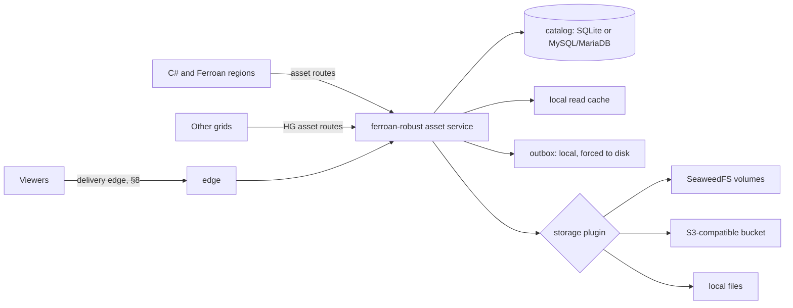

# Asset system

**Status: planned.** Nothing here is built yet. The storage choice is [D23](DECISIONS.md); the rest of the
design is D24 to D28. Tasks are the `AS` rows in [TASKS.md](../TASKS.md).

Ferroan's asset system is a new asset backend served by `ferroan-robust` behind the same asset HTTP routes
the three Tranquillity backends answer (P1.A1 to P1.A3). C# regions, viewers and other grids see the same
routes and forms. What changes is what sits behind them: how bytes are stored, checked, repaired, kept and
moved between grids.

It is planned against Tranquillity with every open OpenSim-NGC pull request merged, as [D21](DECISIONS.md)
allows for the pin. Those already touching assets are #435 and #436 (server-side baking), #440 (unknown flag
bits), #458 (animations gathered), #460 (deletes expire the region cache), #461 (no exit on a read error), #462
(PostgreSQL delete), #463 (AIS asset ids) and #464 (item update caps). The C# fixes this plan adds are the `T.A`
rows in [TASKS.md](../TASKS.md).

## 1. Why

Measured on Tranquillity `f67db54399` (21 November 2026) with an asset-only Robust running FSAssets on MariaDB
11.8 and PostgreSQL 17, driven through its HTTP API, and on the two-grid Hypergrid rig with Ferrobot. Each
problem is a row in [TRANQUILLITY_BUGS.md](TRANQUILLITY_BUGS.md).

| What happens | Effect | Row |
| --- | --- | --- |
| A store whose row insert fails is still answered with the asset's id. Two causes measured: an emoji in the name or description (MySQL `utf8` holds none in strict mode), and the database unreachable | The file is written, the row never is; the asset is lost and the file orphaned | TB22 |
| A file cut short or emptied is served with HTTP 200 (the half that unpacks, or nothing). Storing the same content again, under any id, does not repair it | Damage is served, cached by regions and permanent | TB23 |
| A full disk ends the Robust process; files are written without being forced to disk | One outage takes every service in the process down; power loss leaves short files | TB24 |
| `AssetsExist` answers from the table alone | Hypergrid never re-sends an asset whose copy is damaged | TB25 |
| With `OutboundPermission` at its default, content a visitor makes abroad never reaches home, though the item does | Broken items at home, and nobody is told | TB26 |

Hypergrid also: a foreign copy is stored under the home grid's UUID with no record of where it came from;
the first copy stored under an id wins silently; object XML is rewritten at every hop (4,591 bytes on one grid,
4,559 on the other for the same object), while every other type crosses unchanged; UUID-shaped text in scripts
is fetched as if it were a reference; server-side baking stores visitors' bakes as permanent textures.

## 2. Rules

1. **An id always means the same bytes.** Each asset id is bound to the SHA-256 of its bytes when it is
   created. Nothing overwrites it, with one exception (rule 6).
2. **Stored means stored.** The caller hears "stored" only after the bytes are durable and the catalog row is
   committed. Every failure is reported as a failure.
3. **Nothing damaged is served.** Every read checks the bytes against the hash. A mismatch is answered as
   missing, recorded, and queued for repair.
4. **Nothing damaged gets in.** Uploads and foreign copies are checked by type on the way in (§6).
5. **Any matching copy repairs.** Because the hash is known, bytes from any source that hash to it can
   replace a missing or damaged copy: a new upload, another grid, a region cache, an archive, a backup.
6. **The creator may replace a confirmed-damaged asset**, which gives it new bytes and a new hash under the
   same id. A grid administrator may too, for content whose creator has left or is a Hypergrid visitor. Both are
   recorded in the asset's history.
7. **Every asset has a history**: created, missed, damaged, repaired, replaced, deleted, restored, purged.

## 3. Parts

- **Catalog.** SQLite or MySQL/MariaDB (D23). On MySQL and MariaDB the server checks at startup that its tables
  use `utf8mb4`, strict SQL mode and InnoDB, and refuses to start otherwise. Ids and hashes are stored as text
  (`CHAR(36)`, `CHAR(64)` hex), so an operator can read and join them in SQL.
- **Storage plugins** (D23):
  - **SeaweedFS**, through its native volume API: the master assigns a file id, the bytes go to the volume
    server, and the catalog records the file id. SeaweedFS's filer and its metadata store are not used. Each
    blob carries its hash as its SeaweedFS name, so a scan of the volumes can rebuild the catalog's blob table.
  - **S3-compatible**: SeaweedFS's own gateway, Garage, Cloudflare R2, Backblaze B2, AWS S3. Large assets are one
    object each, keyed by hash. Small ones (scripts, notecards, most objects) are packed into larger objects, so
    stores that charge per request stay cheap.
  - **Local files**, with SQLite, for the smallest standalones: the same packing into large append-only files,
    each record carrying its hash, so the files alone can rebuild the catalog.
- **Local read cache.** Hot assets on local disk, checked against their hash when they are filled. A bucket
  answers in tens of milliseconds, a local disk in under one.
- **Outbox.** When the storage plugin cannot be reached, a store lands in a local directory forced to disk, the
  catalog row points at it, and a worker moves it on. If the outbox cannot be written either, the store fails.

Code lives in a planned crate, `ferroan-assets` (catalog, plugins, checks, integrity, import and sync), served by
`ferroan-robust`.

## 4. Catalog

| Table | Columns | Notes |
| --- | --- | --- |
| `assets` | `id`, `hash`, `type`, `class`, `state`, `name`, `description`, `creator`, `flags`, `origin`, `created_at`, `uploader`, `deleted_at`, `expires_at`, `last_read_day` | `name` and `description` hold any UTF-8. `origin`: `upload`, `region`, `hg:<grid URI>`, `import:<source>`, `bake`, `maptile`. `last_read_day` is written at most once a day per asset |
| `blobs` | `hash`, `size`, `stored_size`, `codec`, `plugin`, `locator`, `state`, `verified_at`, `created_at` | `locator`: a SeaweedFS file id, an S3 key, or a pack and offset. `state`: `ok`, `missing`, `damaged`, `quarantined` |
| `asset_events` | `asset_id`, `at`, `kind`, `detail` | Append-only history (rule 7) |
| `pins` | `asset_id`, `holder_kind`, `holder_id`, `since` | Foreign copies in use on this grid (§7) |

`class` is one of `original`, `foreign`, `bake`, `maptile` or `remote` (§9). Asset rows are never deleted: a
purged asset keeps its row with `state = purged`, so a later read can say when and why.

## 5. Storing and reading

**Store:**
1. Read the body within the per-type size limit, hashing it as it arrives.
2. Check it by type (§6).
3. If a healthy blob with that hash exists, skip the write. If it exists but is missing or damaged, write it:
   this is a repair.
4. Write the blob through the plugin, or into the outbox. Writes are forced to disk in groups every few
   milliseconds, so many stores share one flush.
5. Commit the blob and asset rows in one transaction. An existing id with the same hash is an idempotent
   success. An existing id with a different hash is refused, unless rule 6 applies.
6. Answer.

A crash between steps 4 and 5 leaves a blob with no row. The collector removes it after a grace period, or
an import adopts it (§10). A row never points at bytes that were not written.

**Read:**
1. Look the id up in the catalog (cached in memory). Missing, tombstoned or damaged: answer missing.
2. Fetch the blob from the local cache, else the plugin.
3. Check its hash. On a mismatch, mark the blob damaged, record it, queue a repair, and answer missing.
4. Serve it with `ETag` set to the hash. Assets never change, so delivery may cache them indefinitely
   (`Cache-Control: immutable`). Missing answers are cached for a minute at most, so a repair shows quickly.

**Exists** answers true only for a healthy asset, so Hypergrid and regions re-send damaged ones.

**Compression.** Text types (objects, notecards, scripts, wearables, gestures, settings, materials) are
compressed. Textures, sounds, mesh and animations are stored as they come, since they are compressed already.
The codec must be pure Rust (D8): deflate through `miniz_oxide` to start, zstd only with a pure-Rust encoder or
a decision. The hash is always of the uncompressed bytes.

## 6. Checks on the way in, and repair

| Type | Checked | Repaired without loss |
| --- | --- | --- |
| Texture | JPEG 2000 codestream header and size | A JP2-wrapped codestream is unwrapped |
| Mesh | LLSD header and section offsets | none |
| Object | XML parses, root element | The old `xmlns:xmlns:` serializer fault is cleaned, as C# `SanitizeXml` does |
| Notecard | Linden text format | A wrong text length in the header is corrected |
| Script | UTF-8 text | none |
| Wearable, body part, gesture, landmark | their text formats | none |
| Settings, material | LLSD or glTF JSON parses | none |
| Sound | Ogg header | none |
| Animation | header | none |
| Other types | size limit only | none |

Content that fails its check is refused with an error the uploader sees. A foreign copy that fails is refused
and the miss recorded against its origin.

**Broken textures.** A texture that is missing or damaged shows as a bright pink "texture broken" placeholder,
shipped as a library texture with a fixed id:
- A Ferroan region sends the placeholder's own id to the viewer in place of the broken one. The stored object
  is unchanged, so once the texture is repaired the real id goes out and the viewer loads it.
- C# regions and the delivery edge can only serve the placeholder's bytes under the broken texture's id.
  Viewers then cache pink under that id until their cache is cleared. This is an option, off by default for C#
  regions.

**Repair sources**, tried in order, each checked against the hash: the outbox; a fallback asset service (the
grid's old backend during migration); the origin grid, for foreign copies; region cache files and OAR or IAR
archives, by import (§10); an operator-supplied backup. Rule 6 covers content with no copy anywhere.

## 7. Classes, clean-up and policies

| Class | What it is | Clean-up |
| --- | --- | --- |
| `original` | Content made on this grid, or imported as this grid's | Only after the reference index exists (AS11); until then, report only |
| `foreign` | A copy of another grid's asset, with its origin | Dropped when no pin holds it; fetched again on the next use |
| `bake` | Server-side or viewer bakes | Expires once superseded or after a set time |
| `maptile` | Map tiles and region images | Only the newest per region is kept |
| `remote` | Content that stays on another grid (§9) | Never dropped: it is only a record |

A **pin** is taken when a foreign copy is used where losing it would break something: an object rezzed on this
grid, a worn attachment, an item given to a local resident. While pinned, a foreign copy is kept like an
original.

**Deletes** leave a tombstone. A tombstoned asset can be restored during its grace period, and is purged only
after it.

**Policies** are rules a grid owner writes: a class, an age, how long unreferenced or unpinned, and an action
(`report`, `quarantine`, `purge`). The server enforces floors no policy can lower:

| Floor | Proposed default | Hard minimum |
| --- | --- | --- |
| Quarantine before purge | 30 days | 7 days |
| An `original` unreferenced before it may be quarantined | 365 days | 90 days |
| A new or changed policy runs as a report first | 1 report | 1 report |
| Purges per day | 10,000 | none (owner may lower it) |
| Referenced or pinned assets | never purged | never purged |
| Tombstone rows | kept | kept |

## 8. Delivery to viewers

| Mode | Who can fetch | Notes |
| --- | --- | --- |
| `open` (default) | Anyone with the UUID, as on Second Life's CDN | Textures, mesh, sounds and animations; public CDNs may cache it |
| `session` | A logged-in session's token in the URL | Stops fetching without an account; any UUID is still fetchable once logged in |
| `scene` | Only what the region has shown that avatar, its own inventory and the avatars around it | The region issues grants as it sends updates. Built once Ferroan has its own regions (Phase 2) |
| `region` | Through the region's caps, as OpenSim does today | No edge. C# regions always use this |

No mode stops a viewer that copies what it is sent; a viewer has to receive the bytes to draw them. The modes
raise the cost of mass copying. Hypergrid visitors have no session on this grid; in `session` and `scene` the
region vouches for them.

## 9. Hypergrid

Hypergrid V2 separates who may call (security) from how content moves (content). Each pair of grids settles
the two separately: V1/V1 (stock grids), V2/V1, or V2/V2. V1 security with V2 content is not offered. The
proposal is §14 of the Hypergrid V2 design in Tranquillity (`Docs/feature/hypergrid-v2/`), D28 here.

Work over V1 content as well as V2, because it is how this grid behaves:
- **Leaving the grid is a choice.** The creator's export permission on the item and the grid's export policy
  decide whether content may leave; the stricter wins. The visitor is told when content they take, upload or
  edit will not be sent home.
- **Content going home goes through the outbox**, retried until the home grid accepts it.
- **Foreign copies** are class `foreign` with their origin, pinned while used (§7).
- **Misses say where content was expected from.**

With V2 content only:
- **Manifests**: every asset an item needs, with UUID, SHA-256, type and size; the receiver fetches only what
  it lacks, in resumable batches.
- **Unchanged bytes**: stored bytes are sent as they are, with creator details as signed metadata, so objects
  too keep one hash on every grid. Copies that do not match are refused.
- **Existence by hash**, so a damaged copy or a different asset under the same id is noticed.
- **Content made abroad**: when export is allowed, it reaches home before the home item is created. When it is
  not, the home grid records the item's asset as class `remote` with its grid. A rez at home answers "this item
  stays on <grid>", and the item works whenever its owner visits that grid.

Over V1, objects keep a different hash on each grid. The catalog hashes what it stores, so that is consistent
locally.

## 10. Import, sync and export

`ferroan-robust assets import --from <source>`, from:
- `assetservice:` an `assets` table on SQLite, MySQL or PostgreSQL;
- `xassets:` the `XAssetsMeta` and `XAssetsData` tables;
- `fsassets:` the `fsassets` table and its file tree, including `UseOsgridFormat`;
- `oar:` and `iar:` archives;
- `flotsam:` region cache directories, for recovery only.

Every import:
- reads its source only, never writes to it;
- streams with bounded memory, runs in parallel, and resumes from a checkpoint;
- can be run again safely;
- checks every blob, and sorts every row and file into the classes of the FSAssets audit: ok, genuine empty,
  zero-byte, missing file, unreadable, hash mismatch, object differing only by a trailing NUL, orphan;
- with `--dry-run`, writes nothing and prints that report. It is the grid's health check.

Damaged source rows are imported as damaged, so reads answer missing and repair can find them later.
**Orphan files** are adopted when another source holds bytes for an id that hash to them: a region cache, an
archive. That recovers assets whose rows were lost (TB22). Orphans nothing claims are kept in quarantine, never
deleted by an import.

**Two-way sync with a Tranquillity backend**, so a grid can move over and back:
1. Dry run: the report, nothing written.
2. Import: the first full copy. Hours for millions of assets, possibly a day or more for tens of millions.
3. Shadow: reads still come from the C# backend; every store goes to both; reads are compared, and differences
   are counted.
4. Cut over: reads come from the new store; stores are written through to the C# backend.
5. Stop writing through when the operator is sure. Going back from then on is an export.

New rows on the C# side are picked up by `create_time` with an overlap window; deletes there are found by a
periodic comparison. The return trip loses what the C# backends cannot hold: classes, history and tombstones.
An FSAssets table on MySQL must be converted to `utf8mb4` first, or the export replaces characters it cannot
store, as the operator chooses.

`ferroan-robust assets export --to fsassets:...` writes an FSAssets table and file tree that C# Robust serves.

## 11. Running it

- **One command for small grids**: a Docker Compose bundle with `ferroan-robust`, SeaweedFS (`weed server`) and
  a SQLite catalog on one box ([D18](DECISIONS.md) layout).
- **Growing**: add SeaweedFS volume servers, then turn on replication, then erasure coding for older volumes.
  The asset server's configuration does not change. Move the catalog to MySQL with one copy command.
- **Off-site copies**: a second plugin target, or the storage system's own replication to a bucket elsewhere.
- **Integrity**: a scrubber re-hashes a slice of the store every day, so the whole store is checked over a set
  period (proposed default: 30 days).
- **Readouts** ([D18](DECISIONS.md)): Prometheus counters for reads, misses, damaged, repaired and refused
  assets by type and origin; outbox depth; scrub progress; storage plugin health in `/readyz`.
- **Console**: `assets show <id>` with its history, `assets audit`, `assets repair <id>`,
  `assets policy list | report`, `assets import`, `assets export`, `assets catalog copy`.

## 12. Open questions

1. Compression: deflate to start; is a pure-Rust zstd encoder good enough yet, or is a decision wanted?
2. The S3 client crate: it must add no native library (D8); `reqwest` already brings `rustls` and `ring` (D16).
3. SeaweedFS: confirm which per-blob metadata (name, MIME, extra pairs) survives volume compaction and
   replication, before relying on it to rebuild the catalog.
4. The `session` token format, and how a CDN in front of the edge validates it.
5. The reference index for C# region stores: read their databases directly, or from OARs?
6. Default policy values (§7) and the scrub period, once real numbers come from a grid's dry run.
7. A canonical object form for V1 Hypergrid peers, or objects hashed per grid until V2 content (Hypergrid V2
   §13, question 7).
